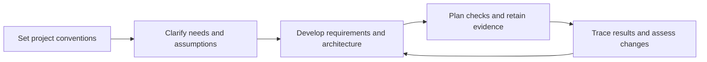
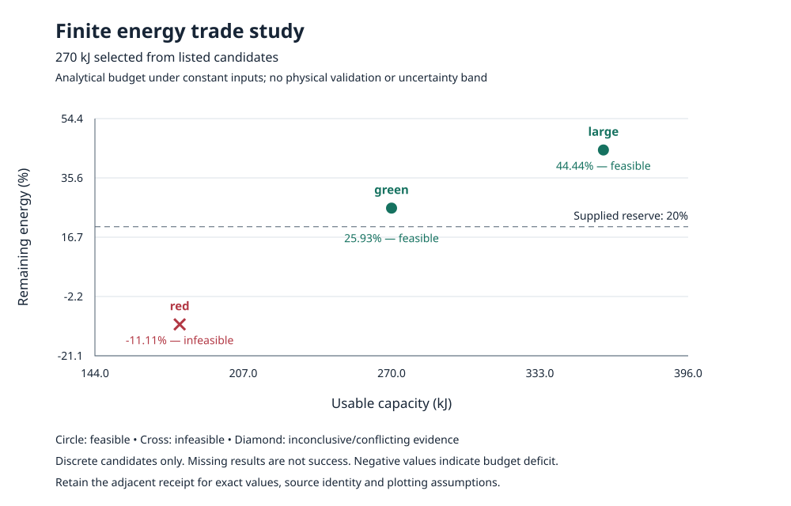

<div align="center">

<h1>MBSE agent skills</h1>

<p>Systems engineering skills guided by a mission-critical engineering ethos.<br>Explicit assumptions. Traceable decisions. Reviewable evidence.</p>

[](https://github.com/DynamicalSystemsGroup/mbse_skills/actions/workflows/checks.yml)
[](LICENSE)
[](docs/share-readiness.md)
[](pyproject.toml)
[](docs/collection-architecture.md)

<p><a href="docs/first-task.md">First task</a> &middot; <a href="docs/skill-guide.md">Choose a skill</a> &middot; <a href="docs/distribution.md">Installation &amp; support</a> &middot; <a href="CONTRIBUTING.md">Contribute</a></p>

</div>

Develop engineering artifacts with **reliability, traceability, auditability and clear communication** as explicit goals. This collection helps your chosen agent turn engineering questions into reviewable requirements, architecture, verification plans and change-impact reports.

**16 skills** cover core systems engineering practices, with optional OOSEM, SysML v2/KerML and visualization extensions. The core works with prose and tables; SysML and an engine are optional.

## Engineering principles

The collection takes its direction from the discipline required for mission-critical systems: make obligations explicit, expose uncertainty, preserve evidence and keep engineering decisions accountable.

| Principle | What it means in the artifacts |
| --- | --- |
| Reliability and assurance | Measurable obligations, explicit operating assumptions, bounded checks and visible failure or inconclusive outcomes |
| Traceability | Stable identities and relationships from needs and assumptions through requirements, architecture, checks and evidence |
| Auditability | Source references, decision status, native observations and artifact identities that a reviewer can inspect |
| Reproducibility and configuration control | Recorded model/tool versions, preserved inputs and explicit review of stale evidence after changes |
| Clear engineering communication | Audience-appropriate views, units, system boundaries and an explanation of what each result establishes |
| Verification and validation | Separate evidence that a stated obligation is met from evidence that the system serves its intended use |
| Human accountability | Proposed agent outputs remain distinct from decisions made by identified engineering authorities |

Read [the engineering principles and review questions](docs/engineering-principles.md). This early-draft collection supports these practices; it is not a qualified toolchain, safety case or evidence that a system is ready for mission-critical use.

## Start here

| You want to… | Start with |
| --- | --- |
| Complete your first engineering task | [Engine-free walkthrough](docs/first-task.md) |
| Find the right skill for existing work | [Task-based skill guide](docs/skill-guide.md) |
| Inspect an end-to-end example | [Rover project and retained evidence](examples/team-onboarding/README.md) |
| Configure local model checks | [Engine setup and development](docs/development.md#configure-and-run-engines) |
| Find engines, editors or model services | [Awesome SysML v2 & MBSE](https://github.com/DynamicalSystemsGroup/awesome-sysmlv2-mbse) |

## Install and try a first task

Onboarding has three steps: **copy the skills into your project, ask the setup skill to record your conventions, then choose one engineering task**. Start with Markdown and tables; add a modeling language or engine when the task needs it. Setup adapts an established project's conventions and can use the editable starter for a new project.

Requires Node.js/npm for installation. From your target engineering project:

```bash
npx skills@1.7.0 add DynamicalSystemsGroup/mbse_skills --agent codex --skill '*' --copy
```

This copies all 16 skills into project-local `.agents/skills`. Version 1.7.0 is the tested installer. No repository clone or Python environment is needed for installation. Then ask your agent:

> Use setup-mbse-skills to configure this project for an illustrative rover energy-budget task. Use Markdown and tables, with tools unconfigured. Record the system boundary, assumptions, requirements and evidence conventions, then identify one requirement to develop with mbse-requirements. Keep all engineering choices proposed until reviewed.

Follow [the first-task walkthrough](docs/first-task.md) for the inputs, next prompt, expected files and completion checks. Selective installation, plugin and manual-copy alternatives are in [distribution and onboarding](docs/distribution.md).

## Customize for your team

The copied skills are ordinary editable files. Choose the practices you need and adapt them to your project; you can begin with a single task without adopting the entire workflow.

| Customize | Where to make the choice |
| --- | --- |
| Document locations, IDs, vocabulary and review responsibilities | Project-owned conventions, normally `docs/mbse-project.md` |
| Methodology and model representation | Select core practices and optional extensions in the [task guide](docs/skill-guide.md); prose and tables remain valid |
| Evidence storage, verification expectations and existing tools | Project conventions, with local tool identities and confidential captures managed separately |
| Skill procedures, references and helpers | The complete copied skill folder under `.agents/skills`, retaining its license and notices |

For selective installation, omit `--skill '*'` and choose skills interactively. Include `setup-mbse-skills` and any composition prerequisites listed in [the catalog](skills/catalog.json); the installer does not resolve those prerequisites. Omit `--agent codex` to select another client, whose support needs its own checks.

Prefer recording project-specific choices in your conventions before changing shared procedures. If you tailor a procedure, keep its inputs, completion criteria, evidence provenance and engineering review responsibilities explicit. Review copied files before replacing them during an update, and reconcile project conventions when the team's workflow changes.

## How the skills fit together



This is an illustrative workflow. Use the skills that fit the task; [the task guide](docs/skill-guide.md) explains all 16. Methodology, language/tool and visualization extensions complement the core practices. The [catalog](skills/catalog.json) records their layers and composition prerequisites.

## What the outputs look like

The [rover onboarding example](examples/team-onboarding/README.md) connects a proposed need to requirements, logical responsibilities, model checks and change impact. Its generated teaching requirement states:

> R-01: Under A-01, the rover shall complete the 2000 m traverse with remaining usable energy >=20% of initial usable battery capacity.

The [runner](scripts/onboarding_demo.py) marks this requirement proposed, leaves the stakeholder owner unresolved and records modeled analysis separately from intended-use validation.

| Artifact | What to inspect |
| --- | --- |
| Requirements and traceability | [Onboarding example](examples/team-onboarding/README.md): generate editable requirements and a hash-bound trace graph from the retained scenario |
| Verification report | [Retained changed-model report](examples/team-onboarding/evidence/changed-model-report.json): both engines accepted model validation and reported the reserve check violated for the 3 km mission |
| Engineering view | [Visualization example](examples/visualization/README.md): source mappings, review records and an energy-budget plot |



These are teaching artifacts with retained observations, not physical rover testing or stakeholder acceptance. Replaying the default onboarding example creates no fresh engine observations.

## Installation and client support

| Route | Recorded evidence | Remaining check |
| --- | --- | --- |
| npx Skills 1.7.0 → Codex project files | Discovery, copy installation and file integrity verified | Native client loading and skill invocation |
| Codex CLI marketplace | Native discovery recorded with local source overrides | Plugin installation and skill invocation |
| Claude Code plugin | Local packaging and documented commands | Native validation, installation and invocation |
| Other clients / manual copies | Portable skill folders and instructions | Client-specific discovery and invocation |

See [installation evidence](docs/distribution.md) for versions and receipts. Installation success and repository checks do not establish agent behavior or complete language conformance.

## About and contribute

Hosted by [Dynamical Systems Group](https://github.com/DynamicalSystemsGroup), this independent project welcomes OpenMBEE and other teams building agent-assisted engineering workflows. Version 0.1.0 is a public early draft with no release tag. Original material is Apache-2.0; [notices](NOTICE.md) explain third-party boundaries. No institutional endorsement is implied.

[Propose a skill or improvement](https://github.com/DynamicalSystemsGroup/mbse_skills/issues/new?template=skill_proposal.md) · [Report a bug](https://github.com/DynamicalSystemsGroup/mbse_skills/issues/new?template=bug_report.md) · [Contribution guide](CONTRIBUTING.md)

For tools and utilities, browse [Awesome SysML v2 & MBSE](https://github.com/DynamicalSystemsGroup/awesome-sysmlv2-mbse); this repository owns the skills and their installation guidance. Read [governance](GOVERNANCE.md), [community conduct](CODE_OF_CONDUCT.md) and [security reporting](SECURITY.md) for collaboration policies.

## Development and evidence

From a full checkout, with Python 3.11+, uv and just available:

```bash
uv sync --locked --offline
just check
```

[Development guide](docs/development.md) covers checks, visualization helpers and calibrated engines. [Sharing readiness](docs/share-readiness.md) records publication and compatibility limits. [Collection architecture](docs/collection-architecture.md) records coverage and extension criteria; [evaluations](evaluations/README.md) describe bounded artifact comparisons.

Risk, safety and several lifecycle practices remain uncovered; additional methodologies and solver integration are future work. Read the documented scope before applying a skill to an engineering decision.
