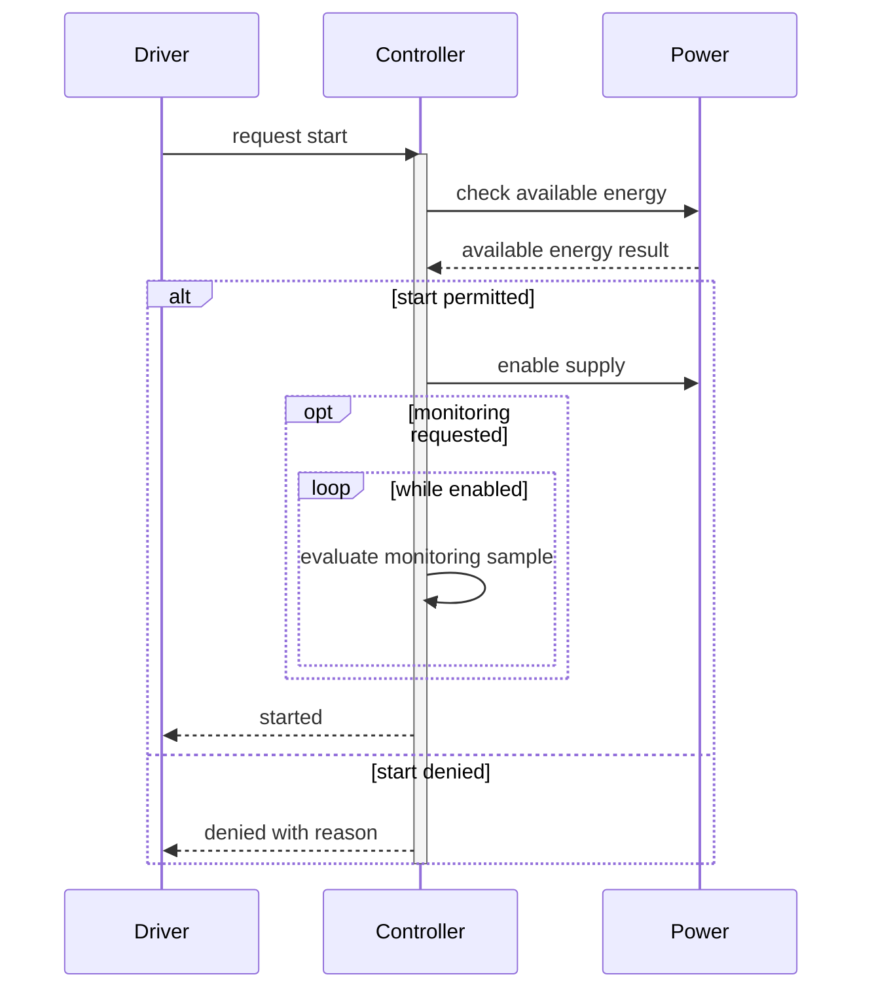
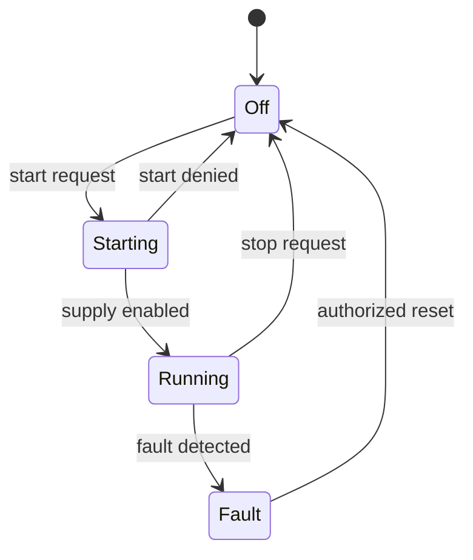

# Behavior view examples

These original Mermaid examples explain a proposed controller. They are not
formal UML/SysML validation or observed vehicle behavior. Native rendering is
not yet tested; run the selected renderer and inspect the export before use.
They are outside the bundled flowchart importer's supported subset.

## Sequence

Map participants and messages to architecture/interface IDs. `start permitted`
needs a defined requirement/guard before becoming a model assertion. Activation
means execution focus in this view, not proven scheduling or duration. Check
that alternative guards cover intended cases, optional behavior is actually
optional, loops have an identified termination condition, self-messages fit
their lifeline and fragment labels do not overlap messages. This example does
not exercise parallel/critical fragments, participant creation/destruction or
quantitative timing.

## State

Map states and transition events to behavior IDs. Record guards and effects in
a companion transition table when prose labels cannot express them precisely.
Distinguish reset authorization from fault detection; absence of an edge does
not establish that an event is forbidden. Check initial/final semantics,
reachability, unresolved events and mutually exclusive guards against the
source model. This example omits concurrency, history and hierarchical states.
